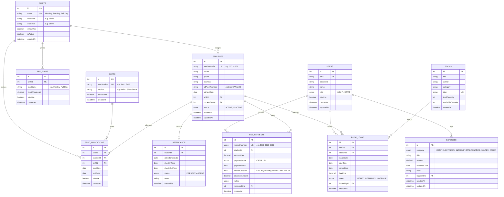

# StudySpace — System Requirements & Technical Specification (PROJECT_SPEC)

**Academic Project Title:** Design and Development of a Web-Based Study Library Management and Operations System (StudySpace)  
**Program:** Master of Computer Applications (MCA)  
**Architecture:** Client-Server Monorepo (React SPA + Node.js Express REST API + PostgreSQL with Prisma ORM)

---

## 1. Project Overview & Scope

**StudySpace** is a centralized, role-based operational management system designed specifically for paid study libraries and reading rooms. It streamlines the day-to-day workflow of managing study seat allocations across distinct daily shifts, student admissions, attendance check-in/check-out registers, monthly fee collections with printable receipts, operational overhead expenses, and a reference book lending inventory.

---

## 2. User Roles & Permissions

The application supports Role-Based Access Control (RBAC) enforced via JWT middleware and database role definitions:

| Role | Permissions & Access Scope |
| :--- | :--- |
| **ADMIN** (Owner / Chief Librarian) | Full system privileges: User management (create staff accounts), student admissions, seat configuration, attendance logs, fee collection, fee plan settings, full expense management (including delete), book inventory & circulation, dashboard KPI metrics, and analytical report exports. |
| **STAFF** (Front Desk Assistant) | Operational privileges: Student lookup & admission, daily attendance marking (check-in/check-out), recording fee payments & issuing receipts, issuing and returning books, viewing expenses, and adding daily expenses. **Restricted:** Cannot delete expenses, cannot modify system fee plans or seat master definitions, and cannot create/manage staff accounts. |

---

## 3. Database Design & 3NF Entity Relationship Model

The relational database is designed in **Third Normal Form (3NF)** to eliminate redundancy, avoid update anomalies, and maintain strict referential integrity.

### 3.1 Mermaid Entity Relationship Diagram



---

## 4. Relational Database Tables & Schema Specification

### 1. `users`
- `id` (SERIAL, PK)
- `email` (VARCHAR(150), UNIQUE, NOT NULL, Indexed)
- `password` (VARCHAR(255), NOT NULL) — bcrypt hashed
- `name` (VARCHAR(100), NOT NULL)
- `role` (ENUM('ADMIN', 'STAFF'), DEFAULT 'STAFF', NOT NULL)
- `isActive` (BOOLEAN, DEFAULT TRUE, NOT NULL)
- `createdAt` (TIMESTAMP, DEFAULT NOW())
- `updatedAt` (TIMESTAMP, AUTO UPDATE)

### 2. `shifts`
- `id` (SERIAL, PK)
- `name` (VARCHAR(50), UNIQUE, NOT NULL) — e.g. "Morning", "Evening", "Full Day"
- `startTime` (VARCHAR(10), NOT NULL) — e.g. "06:00 AM"
- `endTime` (VARCHAR(10), NOT NULL) — e.g. "02:00 PM"
- `defaultFee` (DECIMAL(10, 2), NOT NULL)
- `isActive` (BOOLEAN, DEFAULT TRUE, NOT NULL)
- `createdAt` (TIMESTAMP, DEFAULT NOW())

### 3. `seats`
- `id` (SERIAL, PK)
- `seatNumber` (VARCHAR(20), UNIQUE, NOT NULL) — e.g. "S-01", "S-02"
- `section` (VARCHAR(50), DEFAULT 'Main Hall')
- `isAvailable` (BOOLEAN, DEFAULT TRUE, NOT NULL)
- `createdAt` (TIMESTAMP, DEFAULT NOW())

### 4. `seat_allocations`
- `id` (SERIAL, PK)
- `seatId` (INTEGER, FK -> seats.id ON DELETE RESTRICT, NOT NULL)
- `studentId` (INTEGER, FK -> students.id ON DELETE CASCADE, NOT NULL)
- `shiftId` (INTEGER, FK -> shifts.id ON DELETE RESTRICT, NOT NULL)
- `startDate` (DATE, NOT NULL)
- `endDate` (DATE, NULLABLE)
- `isActive` (BOOLEAN, DEFAULT TRUE, NOT NULL)
- `createdAt` (TIMESTAMP, DEFAULT NOW())
- **Constraint:** Unique active allocation per seat and shift: `UNIQUE (seatId, shiftId, isActive)` where `isActive = TRUE`.

### 5. `students`
- `id` (SERIAL, PK)
- `studentCode` (VARCHAR(20), UNIQUE, NOT NULL, Indexed) — e.g. "STU-1001"
- `name` (VARCHAR(100), NOT NULL)
- `phone` (VARCHAR(15), NOT NULL)
- `address` (TEXT, NOT NULL)
- `idProofNumber` (VARCHAR(50), NOT NULL) — Aadhaar / PAN / Voter ID
- `joiningDate` (DATE, NOT NULL, DEFAULT CURRENT_DATE)
- `shiftId` (INTEGER, FK -> shifts.id ON DELETE RESTRICT, NOT NULL)
- `currentSeatId` (INTEGER, FK -> seats.id ON DELETE SET NULL, NULLABLE)
- `status` (ENUM('ACTIVE', 'INACTIVE'), DEFAULT 'ACTIVE', NOT NULL, Indexed)
- `createdAt` (TIMESTAMP, DEFAULT NOW())
- `updatedAt` (TIMESTAMP, AUTO UPDATE)

### 6. `attendance`
- `id` (SERIAL, PK)
- `studentId` (INTEGER, FK -> students.id ON DELETE RESTRICT, NOT NULL)
- `attendanceDate` (DATE, NOT NULL, Indexed)
- `checkInTime` (VARCHAR(10), NULLABLE) — e.g. "08:15 AM"
- `checkOutTime` (VARCHAR(10), NULLABLE) — e.g. "02:00 PM"
- `status` (ENUM('PRESENT', 'ABSENT'), DEFAULT 'PRESENT', NOT NULL)
- `notes` (VARCHAR(255), NULLABLE)
- `createdAt` (TIMESTAMP, DEFAULT NOW())
- **Constraint:** Unique attendance record per student per date: `UNIQUE (studentId, attendanceDate)`.

### 7. `fee_plans`
- `id` (SERIAL, PK)
- `shiftId` (INTEGER, FK -> shifts.id ON DELETE RESTRICT, NOT NULL)
- `planName` (VARCHAR(100), NOT NULL) — e.g. "Standard Morning Shift"
- `monthlyAmount` (DECIMAL(10, 2), NOT NULL)
- `isActive` (BOOLEAN, DEFAULT TRUE, NOT NULL)
- `createdAt` (TIMESTAMP, DEFAULT NOW())

### 8. `fee_payments`
- `id` (SERIAL, PK)
- `receiptNumber` (VARCHAR(30), UNIQUE, NOT NULL, Indexed) — e.g. "REC-2026-0001"
- `studentId` (INTEGER, FK -> students.id ON DELETE RESTRICT, NOT NULL)
- `amountPaid` (DECIMAL(10, 2), NOT NULL)
- `paymentMode` (ENUM('CASH', 'UPI'), NOT NULL)
- `paymentDate` (DATE, NOT NULL, DEFAULT CURRENT_DATE, Indexed)
- `monthCovered` (DATE, NOT NULL, Indexed) — Stored as first date of month (e.g. `2026-10-01`)
- `discountAmount` (DECIMAL(10, 2), DEFAULT 0.00)
- `notes` (TEXT, NULLABLE)
- `receivedById` (INTEGER, FK -> users.id ON DELETE RESTRICT, NOT NULL)
- `createdAt` (TIMESTAMP, DEFAULT NOW())

### 9. `expenses`
- `id` (SERIAL, PK)
- `category` (ENUM('RENT', 'ELECTRICITY', 'INTERNET', 'MAINTENANCE', 'SALARY', 'OTHER'), NOT NULL, Indexed)
- `title` (VARCHAR(150), NOT NULL)
- `amount` (DECIMAL(10, 2), NOT NULL)
- `expenseDate` (DATE, NOT NULL, Indexed)
- `note` (TEXT, NULLABLE)
- `loggedById` (INTEGER, FK -> users.id ON DELETE RESTRICT, NOT NULL)
- `createdAt` (TIMESTAMP, DEFAULT NOW())
- `updatedAt` (TIMESTAMP, AUTO UPDATE)

### 10. `books`
- `id` (SERIAL, PK)
- `title` (VARCHAR(200), NOT NULL)
- `author` (VARCHAR(150), NOT NULL)
- `category` (VARCHAR(100), NOT NULL)
- `isbn` (VARCHAR(50), UNIQUE, NULLABLE)
- `totalQuantity` (INTEGER, NOT NULL, CHECK >= 1)
- `availableQuantity` (INTEGER, NOT NULL)
- `createdAt` (TIMESTAMP, DEFAULT NOW())

### 11. `book_loans`
- `id` (SERIAL, PK)
- `bookId` (INTEGER, FK -> books.id ON DELETE RESTRICT, NOT NULL)
- `studentId` (INTEGER, FK -> students.id ON DELETE RESTRICT, NOT NULL)
- `issueDate` (DATE, NOT NULL, DEFAULT CURRENT_DATE)
- `dueDate` (DATE, NOT NULL)
- `returnDate` (DATE, NULLABLE)
- `lateFine` (DECIMAL(10, 2), DEFAULT 0.00)
- `status` (ENUM('ISSUED', 'RETURNED', 'OVERDUE'), DEFAULT 'ISSUED', NOT NULL, Indexed)
- `issuedById` (INTEGER, FK -> users.id ON DELETE RESTRICT, NOT NULL)
- `createdAt` (TIMESTAMP, DEFAULT NOW())

---

## 5. Core Business Logic & Rules

### Rule 1: Seat Double-Booking Prevention per Shift
- In a study library, multiple students can use the same physical desk if they are enrolled in different shifts (e.g., Student A uses Seat S-01 in the Morning Shift from 6 AM to 2 PM, while Student B uses Seat S-01 in the Evening Shift from 2 PM to 10 PM).
- **Enforcement:** A seat cannot be double-booked for the same shift simultaneously. When allocating a seat, the system checks whether an active allocation exists for `(seatId, shiftId, isActive=true)`. If found, the allocation is rejected with HTTP 409 Conflict.

### Rule 2: Attendance Check-In / Check-Out & Duplicate Prevention
- An enrolled student can only have one attendance log per calendar date.
- **Enforcement:** Enforced via composite unique key `(studentId, attendanceDate)`.
- If a student is checked in, their `checkInTime` is stamped. When checking out, `checkOutTime` is updated. Marking attendance again on the same day updates the existing record rather than inserting duplicates.

### Rule 3: Monthly Fee Billing, Receipts, and Dues Calculation
- Each active student has an expected monthly fee defined by their assigned shift's active fee plan.
- **Due Tracking:** For any given billing month, if a student has not paid or paid less than their required monthly fee plan, they appear on the "Pending Dues" list.
- **Receipt Generation:** Every payment generates an immutable receipt number (format `REC-YYYY-XXXX`) along with printable receipt metadata (Student name, Seat No, Shift, Amount, Mode, Date, Covered Month, and Cashier Name).

### Rule 4: Book Stock Synchronization & Late Fine Computation
- Total physical copies in catalog = `totalQuantity`.
- Real-time available copies = `totalQuantity - COUNT(active unreturned loans)`.
- When issuing a book: Available copies must be $> 0$. Issuance decrements `availableQuantity` by 1.
- When returning a book: System records `returnDate`. If `returnDate > dueDate`, a configurable late fine (e.g., ₹5 per day overdue) is automatically computed. `availableQuantity` increments by 1.

---

## 6. REST API Endpoint Specification

All endpoints under `/api/*` return standard JSON:
- Success: `{ "success": true, "data": ..., "message": "..." }`
- Error: `{ "success": false, "error": "...", "statusCode": ... }`

### 6.1 Authentication (`/api/auth`)
| Method | Endpoint | Role | Description |
| :--- | :--- | :--- | :--- |
| `POST` | `/api/auth/login` | Public | Authenticates credentials and returns JWT token & user info. |
| `GET` | `/api/auth/me` | Authenticated | Returns currently authenticated user profile. |
| `POST` | `/api/auth/logout` | Authenticated | Client-side invalidation / server-side token audit log. |

### 6.2 Students (`/api/students`)
| Method | Endpoint | Role | Description |
| :--- | :--- | :--- | :--- |
| `GET` | `/api/students` | Authenticated | List students with search, shift filter, and status filter. |
| `GET` | `/api/students/:id` | Authenticated | Get student details, allocated seat, and history. |
| `POST` | `/api/students` | Authenticated | Register new student admission. |
| `PUT` | `/api/students/:id` | Authenticated | Update student profile or change shift. |
| `PATCH` | `/api/students/:id/status`| Authenticated | Toggle student status (Active/Inactive). |
| `DELETE` | `/api/students/:id` | ADMIN only | Soft delete student record (retains audit trails). |

### 6.3 Seats & Shifts (`/api/seats`, `/api/shifts`)
| Method | Endpoint | Role | Description |
| :--- | :--- | :--- | :--- |
| `GET` | `/api/shifts` | Authenticated | List all active reading room shifts and default fees. |
| `POST` | `/api/shifts` | ADMIN only | Create new study shift tier. |
| `PUT` | `/api/shifts/:id` | ADMIN only | Update study shift details/timings. |
| `GET` | `/api/seats` | Authenticated | List all library seats with per-shift occupancy status. |
| `POST` | `/api/seats` | ADMIN only | Add new seat numbering to library master. |
| `POST` | `/api/seats/allocate`| Authenticated | Allocate seat to student for a shift (verifies availability). |
| `POST` | `/api/seats/unassign`| Authenticated | Release/unassign seat from student. |

### 6.4 Attendance (`/api/attendance`)
| Method | Endpoint | Role | Description |
| :--- | :--- | :--- | :--- |
| `GET` | `/api/attendance` | Authenticated | Get attendance register for a specific date. |
| `POST` | `/api/attendance/check-in` | Authenticated | Mark check-in for student on given date. |
| `POST` | `/api/attendance/check-out`| Authenticated | Mark check-out time for student on given date. |
| `POST` | `/api/attendance/batch` | Authenticated | Mark multiple students present/absent for selected date. |
| `GET` | `/api/attendance/student/:id`| Authenticated | Monthly attendance summary and percentage for a student. |

### 6.5 Fees & Payments (`/api/fees`)
| Method | Endpoint | Role | Description |
| :--- | :--- | :--- | :--- |
| `GET` | `/api/fees/plans` | Authenticated | List monthly fee plans by shift. |
| `POST` | `/api/fees/plans` | ADMIN only | Create or update fee plan. |
| `GET` | `/api/fees/payments` | Authenticated | List payment records with date/student/mode filters. |
| `POST` | `/api/fees/payments` | Authenticated | Record fee payment (returns receipt metadata). |
| `GET` | `/api/fees/receipt/:id` | Authenticated | Get printable receipt data for payment ID. |
| `GET` | `/api/fees/dues` | Authenticated | Get list of students with overdue / pending fees for month. |

### 6.6 Expenses (`/api/expenses`)
| Method | Endpoint | Role | Description |
| :--- | :--- | :--- | :--- |
| `GET` | `/api/expenses` | Authenticated | List operational expenses with category and date range filter. |
| `POST` | `/api/expenses` | Authenticated | Log operational expense (rent, electricity, wifi, etc.). |
| `PUT` | `/api/expenses/:id` | Authenticated | Edit existing expense entry. |
| `DELETE` | `/api/expenses/:id` | ADMIN only | Delete expense entry (**Blocked for STAFF role**). |
| `GET` | `/api/expenses/summary` | Authenticated | Monthly total expenses categorized. |

### 6.7 Book Inventory & Circulation (`/api/books`)
| Method | Endpoint | Role | Description |
| :--- | :--- | :--- | :--- |
| `GET` | `/api/books` | Authenticated | List books with real-time available copy count. |
| `POST` | `/api/books` | ADMIN only | Add new book title and quantity to catalog. |
| `PUT` | `/api/books/:id` | ADMIN only | Update book catalog details. |
| `GET` | `/api/books/loans` | Authenticated | List active and historical book loans. |
| `POST` | `/api/books/issue` | Authenticated | Issue book to student (validates stock > 0). |
| `POST` | `/api/books/return/:loanId` | Authenticated | Return book (updates stock and calculates late fines). |

### 6.8 Dashboard & Reports (`/api/dashboard`, `/api/reports`)
| Method | Endpoint | Role | Description |
| :--- | :--- | :--- | :--- |
| `GET` | `/api/dashboard/stats` | Authenticated | Aggregated metrics (total/active students, today attendance, collection, expenses, net income). |
| `GET` | `/api/dashboard/charts` | Authenticated | Monthly income vs expense and attendance trend charts. |
| `GET` | `/api/reports/collections` | Authenticated | Fee collections report with CSV export payload. |
| `GET` | `/api/reports/dues` | Authenticated | Outstanding fee dues report. |
| `GET` | `/api/reports/expenses` | Authenticated | Categorized expense report. |
| `GET` | `/api/reports/attendance` | Authenticated | Attendance summary report by date range. |

---

## 7. Project Monorepo Folder Structure

```
StudySpace/
├── package.json               # Root scripts (start, dev, seed, build)
├── PROJECT_SPEC.md            # Master specification document (this file)
│
├── backend/                   # Node.js + Express REST API
│   ├── package.json
│   ├── .env.example           # PORT, DATABASE_URL, JWT_SECRET, JWT_EXPIRES_IN
│   ├── prisma/
│   │   ├── schema.prisma      # PostgreSQL Prisma 3NF Schema
│   │   ├── migrations/        # SQL migration history
│   │   └── seed.ts            # Realistic seed script (1 admin, 1 staff, 30 students, 3mo logs, 20 books)
│   └── src/
│       ├── server.ts          # Express app entry & HTTP server
│       ├── config/            # Environment variable loader
│       ├── middleware/
│       │   ├── auth.middleware.ts     # JWT token verification
│       │   ├── role.middleware.ts     # Role-based guard (ADMIN vs STAFF)
│       │   └── error.middleware.ts    # Global exception handler & error response
│       ├── controllers/
│       │   ├── auth.controller.ts
│       │   ├── student.controller.ts
│       │   ├── seat.controller.ts
│       │   ├── attendance.controller.ts
│       │   ├── fee.controller.ts
│       │   ├── expense.controller.ts
│       │   ├── book.controller.ts
│       │   └── report.controller.ts
│       ├── routes/
│       │   ├── auth.routes.ts
│       │   ├── student.routes.ts
│       │   ├── seat.routes.ts
│       │   ├── attendance.routes.ts
│       │   ├── fee.routes.ts
│       │   ├── expense.routes.ts
│       │   ├── book.routes.ts
│       │   └── report.routes.ts
│       └── utils/
│           ├── receiptGenerator.ts    # Receipt numbering formatter
│           └── fineCalculator.ts      # Late fine computation logic
│
└── frontend/                  # React 19 + TypeScript + Vite + Tailwind CSS
    ├── package.json
    ├── .env.example           # VITE_API_BASE_URL=http://localhost:5000/api
    ├── vite.config.ts
    ├── index.html
    └── src/
        ├── main.tsx
        ├── App.tsx            # Route definitions & Role guards
        ├── api/               # Axios client instance with auth interceptors
        ├── context/           # AuthContext (user, token, role, login, logout)
        ├── components/        # Navbar, Sidebar, Modal, Badge, StatCard, EmptyState, Table
        ├── pages/
        │   ├── Login.tsx
        │   ├── Dashboard.tsx
        │   ├── Students.tsx
        │   ├── SeatsAndShifts.tsx
        │   ├── Attendance.tsx
        │   ├── Fees.tsx       # Invoicing, payment recording & printable receipt
        │   ├── Expenses.tsx   # Operational expenditures
        │   ├── Books.tsx      # Inventory & loans
        │   └── Reports.tsx    # Monthly reports & CSV export
        └── utils/
            ├── formatters.ts  # Currency (INR ₹) & date formatters
            └── csvExport.ts   # RFC-4180 CSV generation & download
```

---

## 8. Development Phases & Roadmap

- **Phase 0:** Requirements & Architecture Specification (`PROJECT_SPEC.md`) — *(Current Phase)*
- **Phase 1:** Backend Setup (Express + PostgreSQL Prisma ORM schema + Initial Migration + Seed Script)
- **Phase 2:** Authentication & RBAC (JWT, bcrypt, auth middleware, role guards, Admin/Staff seed)
- **Phase 3:** Core Operational APIs (Students, Seats/Shifts with double-booking lock, Attendance check-in/out, Fees with receipt generation, Expenses with staff delete restriction, Books with auto availability)
- **Phase 4:** Frontend Setup & Integration (Vite + React + Tailwind + React Router + Axios client + Auth Context)
- **Phase 5:** Functional UI Modules (Students, Seat Grid, Attendance Register, Fee Collection & Printable Receipt, Expenses, Books Circulation)
- **Phase 6:** Dashboard, Analytical Charts (Recharts), Reports & CSV Export
- **Phase 7:** End-to-End Testing, Polish, and Academic Viva Preparation Guide
